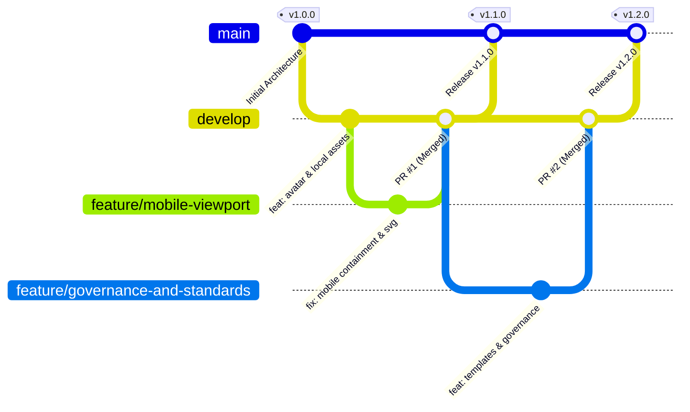

<div align="center">

# ⚡ Mauricio Oliveira | Engenheiro de Software Full Stack & Java Specialist

[](https://mauricio-g-oliveira.github.io/)
[-informational?style=flat-square)](https://github.com/Mauricio-G-Oliveira/Mauricio-G-Oliveira.github.io/releases)
[](LICENSE)

<br/>

**Website Oficial no ar**: 👉 **[https://mauricio-g-oliveira.github.io/](https://mauricio-g-oliveira.github.io/)**

<p align="center">
  
  
  
  
  
  
</p>

</div>

---

## 📌 Visão Geral da Engenharia

Este repositório abriga o código-fonte do portfólio profissional de **Mauricio Oliveira**, construído com foco em **altíssimo desempenho, design de nível sênior (estilo Vercel / Linear)**, **governança de código**, **padrões de engenharia** e **estratégia robusta de branches**.

O portfólio destaca competências em arquitetura corporativa, microsserviços, modelagem de banco de dados relacional de alta concorrência e projetos em produção (Orprocon / Net Data, MakerPixel, StageFlow).

---

## 🌳 Estratégia de Branches & Governança (Git Flow)

Para garantir previsibilidade, rastreabilidade e integridade de produção, o repositório segue um modelo estruturado de branches com versionamento semântico:



### Papel de Cada Branch:
- **`main` (Production)**: Código estável de produção. O deploy contínuo do **GitHub Pages** é executado a partir desta branch.
- **`develop` (Integration / Staging)**: Ambiente de integração contínua onde novas funcionalidades são consolidadas antes de releases oficiais.
- **`feature/*`**: Branches de ciclo de vida curto para novas implementações e experimentos isolados.
- **`hotfix/*`**: Correções urgentes com merge simultâneo em `main` e `develop`.

Consulte o [Guia de Contribuição e Governança (CONTRIBUTING.md)](CONTRIBUTING.md) para diretrizes sobre Conventional Commits e Pull Requests.

---

## 🚀 Projetos em Destaque no Portfólio

| Projeto | Stack Tecnológico | Tipo | Destaque de Engenharia |
| :--- | :--- | :--- | :--- |
| **StageFlow API REST** | Java 21, Spring Boot 3, PostgreSQL, Docker, JWT | Open Source | API RESTful com autenticação granular, tratamento global de exceções e persistência relacional. |
| **StageFlow Front-End** | React, TypeScript, Vite, Tailwind CSS | Open Source | Aplicação reativa de alta performance para gestão de eventos e repertório musical. |
| **Conciliação Contábil** | Java, Spring Boot, PostgreSQL, Clean Architecture | Enterprise (Orprocon) | Redução de 85% no tempo de conferência contábil mensal e integridade transacional ACID. |
| **Gestão de Pessoas & RBAC** | Spring Security, JWT, React, PostgreSQL | Enterprise (Orprocon) | Controle de acesso por papéis (RBAC), auditoria de logs e compliance. |
| **MakerPixel Platform** | React, TypeScript, Tailwind CSS, UI/UX | Produção | Ecossistema web institucional com alta conversão e otimização para SEO. |
| **Portal Banda Livert** | JavaScript, Multimídia, Mobile First | Open Source | Plataforma de divulgação e gestão de shows com streaming de mídia responsivo. |

---

## 📂 Arquitetura do Repositório

```text
├── .github/
│   ├── ISSUE_TEMPLATE/
│   │   ├── bug_report.md              # Template de reporte de bugs
│   │   └── feature_request.md         # Template de novas funcionalidades
│   └── pull_request_template.md       # Template corporativo de Pull Request com checklist
├── css/
│   └── styles.css                     # Estilização modular, glassmorphism e dark mode
├── js/
│   └── main.js                        # Lógica interativa, filtros reativos, modal e terminal
├── avatar.jpg                         # Imagem oficial de perfil em alta resolução
├── CONTRIBUTING.md                    # Diretrizes de contribuição, Git Flow e Conventional Commits
├── index.html                         # Estrutura semântica, responsiva e otimizada para SEO
├── LICENSE                            # Licença MIT de código aberto
├── Profile.pdf                        # Currículo executivo oficial para download/visualização
└── README.md                          # Documentação técnica e governança do projeto
```

---

## 📦 Histórico de Versões (SemVer)

- **`v1.2.0`** *(Atual)*: Governança corporativa completa, templates de PR/Issues, licença MIT, diretrizes de Git Flow e documentação técnica avançada.
- **`v1.1.0`**: Refatoração da responsividade mobile, contenção estrita de viewport, eliminação de overflow horizontal e menu hambúrguer com SVG nativo.
- **`v1.0.0`**: Lançamento inicial da plataforma, integração dos projetos reais do GitHub e publicação no GitHub Pages.

---

## 📬 Contato Profissional

- **LinkedIn**: [linkedin.com/in/mauriciogoulartdev](https://www.linkedin.com/in/mauriciogoulartdev)
- **GitHub**: [github.com/Mauricio-G-Oliveira](https://github.com/Mauricio-G-Oliveira)
- **WhatsApp**: [(48) 98457-0272](https://wa.me/5548984570272)
- **E-mail**: [mauriciogoulart.deoliveira37@gmail.com](mailto:mauriciogoulart.deoliveira37@gmail.com)

---

<div align="center">
  <sub>Desenvolvido com foco em excelência técnica, código sustentável e arquitetura de alto impacto.</sub>
</div>
